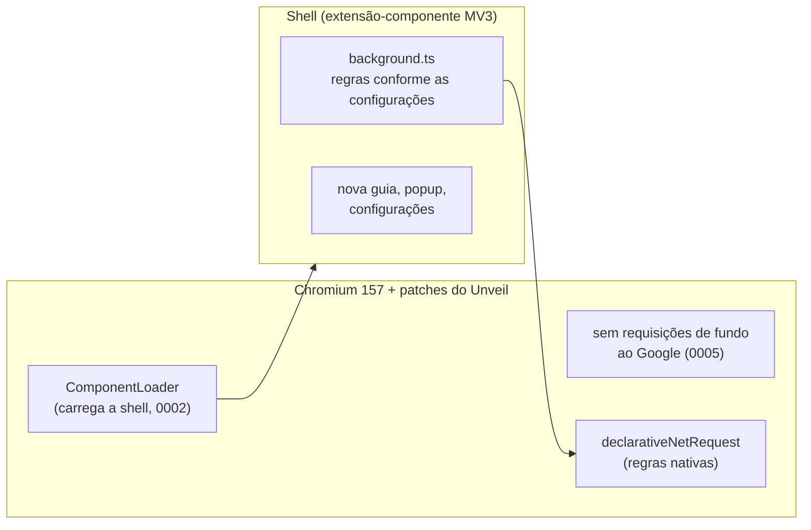

# Unveil

Um navegador leve e sem rastreamento para Windows, feito sobre um fork do Chromium.

<p align="center"></p>

## Por quê

O [Flecha](https://flecha.dev/pt-br/) mostrou que dá para fazer um navegador próprio sem carregar um fork gigante: Chromium de verdade, poucos patches e a interface como uma extensão embutida em TypeScript. Mas ele só roda no macOS. O Unveil segue a mesma receita no Windows, com foco em privacidade: nenhum dado sobre você sai do navegador, e anúncios e rastreadores ficam bloqueados desde o primeiro uso.

É o Chromium mesmo, e não um app Electron. As páginas renderizam igual ao Chrome, e as extensões da Chrome Web Store instalam normalmente.

## Recursos

**Sem rastreamento**
- Sem atualizações de componentes do Google (`update.googleapis.com`), sem relatórios de Domain Reliability e sem pings de auditoria de links (`<a ping>`), em toda inicialização (patch 0005).
- Sem chaves de API do Google, então não há login nem sincronização com o Google. Sem telemetria e sem relatórios de falha.
- Num perfil novo ([`initial_preferences`](chromium/build/initial_preferences)):
  - DuckDuckGo como buscador, sem sugestões enquanto você digita;
  - cookies de terceiros bloqueados;
  - HTTPS-First;
  - WebRTC sem expor o IP local;
  - sem pré-carregamento de páginas, Safe Browsing, tradutor, Media Router ou serviço de ortografia do Google.

  São preferências, então dá para mudar em `chrome://settings`.
- Não precisa de conta. Seus dados ficam em `%LOCALAPPDATA%\Unveil\User Data`.

**Bloqueio de anúncios e rastreadores**
- EasyList e EasyPrivacy, ligadas por padrão. No build, cerca de 114 mil filtros viram cerca de 12,8 mil regras `declarativeNetRequest`, que o próprio Chromium aplica em código nativo, sem JavaScript a cada requisição.
- Tira `utm_*`, `fbclid`, `gclid`, `msclkid` e outros parâmetros de rastreamento dos links que você abre.
- O botão do Unveil na barra de ferramentas mostra quantos itens foram bloqueados na página e desliga a proteção só naquele site.

**Nova guia para desenvolvedores**
- `gh dono/repo`, `npm pacote`, `mdn`, `caniuse` e `so` seguidos dos termos da busca.
- Cole um JWT ou um timestamp Unix para decodificar. O JWT é decodificado na própria página e não é enviado a lugar nenhum.
- Endereços abrem direto (`localhost:3000`, `exemplo.com.br`). O resto vai para o buscador que você escolher.

**O resto do navegador**
- Nomes e IDs próprios no Windows (patch 0001), então instala ao lado do Chrome ou do Chromium sem conflito.
- "Chromium" vira "Unveil" em todos os textos da interface, sem perder nenhuma tradução.
- Interface própria em português e inglês, nos temas claro e escuro.

<p align="center"></p>

## Instalação

1. Baixe a versão mais recente em [Releases](https://github.com/daltonfontes/unveil-browser/releases):
   - `Unveil-<versão>-x64-installer.exe` instala só para o seu usuário, em `%LOCALAPPDATA%\Unveil`, sem pedir administrador;
   - `Unveil-<versão>-x64.zip` traz os mesmos arquivos: é só descompactar e abrir o `chrome.exe`.
2. Os binários não são assinados, então na primeira execução o Windows SmartScreen pode mostrar um aviso. Clique em **Mais informações → Executar assim mesmo**.

## Compilar

Você precisa de:

- Windows 10/11 x64, com uns 100 GB livres num SSD e 16 GB de RAM ou mais (32 GB ajudam bastante)
- Visual Studio 2022 com "Desenvolvimento para desktop com C++", os componentes de C++ ATL e MFC e o Windows SDK. Veja as [instruções de build do Chromium para Windows](https://chromium.googlesource.com/chromium/src/+/main/docs/windows_build_instructions.md#visual-studio).
- Git, Node 22.18 ou mais novo e 7-Zip (só para empacotar)
- [depot_tools](https://commondatastorage.googleapis.com/chrome-infra-docs/flat/depot_tools/docs/html/depot_tools_tutorial.html) (o `fetch.ps1` instala se não tiver)
- um checkout do Chromium na versão de [`chromium/build/CHROMIUM_VERSION`](chromium/build/CHROMIUM_VERSION), que hoje é a 157. O `fetch.ps1` baixa: uns 40 GB, e uma hora ou mais.

O [`chromium/scripts/env.ps1`](chromium/scripts/env.ps1) define onde fica cada coisa, e todos os scripts leem dele. Por padrão o checkout fica em `C:\src\chromium\src` e o depot_tools em `C:\src\depot_tools`. Para mudar, use as variáveis `CHROMIUM_SRC`, `DEPOT_TOOLS` e `UNVEIL_PROFILE` (o perfil de desenvolvimento).

Rode no PowerShell (se o Windows bloquear scripts: `Set-ExecutionPolicy -Scope CurrentUser RemoteSigned`):

```powershell
git clone https://github.com/daltonfontes/unveil-browser.git
cd unveil-browser
npm ci
chromium\scripts\fetch.ps1         # uma vez: depot_tools e o Chromium na versão certa
```

### O ciclo de desenvolvimento

```powershell
chromium\scripts\build.ps1         # apply.ps1 (marca, patches, textos) e autoninja -C out\Dev chrome
chromium\scripts\run.ps1           # abre out\Dev\chrome.exe com um perfil próprio
npm run shell:build                # mudou só a interface? recompile a shell e reabra o run.ps1
npm run typecheck
npm test                           # testes unitários
npm run test:e2e                   # a shell num Chromium real: bloqueio, links, nova guia
```

Você pode rodar o `apply.ps1` quantas vezes quiser: ele desfaz a aplicação anterior antes de aplicar de novo. O build de desenvolvimento é um component build, então uma mudança só religa uma DLL pequena. O `run.ps1` carrega a shell de `chromium\shell\dist` pelo `--unveil-shell-dir`, então mexer na interface não exige compilar o Chromium (o `npm run shell:watch` recompila ao salvar).

### Release

```powershell
chromium\scripts\build-release.ps1     # várias horas na primeira vez; pode ser retomado
chromium\scripts\publish-release.ps1   # cria a release v<versão> no GitHub (gh)
```

O `build-release.ps1` faz, nesta ordem:
1. compila a shell e roda o `apply.ps1`;
2. copia a shell e o `initial_preferences` para dentro do checkout;
3. gera o `out\Release\args.gn` a partir do [`chromium/build/release.gn`](chromium/build/release.gn);
4. compila o `chrome` e o instalador (`mini_installer`);
5. chama o `package-release.ps1`, que deixa em `dist\` o instalador, o zip e o `SHA256SUMS.txt`.

Com `UNVEIL_OFFICIAL=1`, ele adiciona `is_official_build`: o navegador sai menor e mais rápido, mas a etapa de link pede uns 64 GB de RAM. Os codecs H.264 e AAC vêm ligados para os vídeos tocarem em todo lugar; veja a observação sobre patentes no `release.gn`.

## Organização do repositório

```
chromium/
  patches/       as mudanças no Chromium, como diffs unificados numerados
  branding/      ícone, logos, BRANDING (logo.svg é a fonte de todos)
  build/         CHROMIUM_VERSION, dev.gn e release.gn (args do GN), initial_preferences
  scripts/       env, fetch, apply, build, run, build-release, package-release,
                 publish-release (PowerShell); check-patches, rebrand,
                 render-branding (Node)
  shell/         a extensão MV3 embutida que traz a interface do Unveil
    build.mjs         bundle com esbuild; baixa e converte as listas de bloqueio
    abp2dnr.mjs       filtros Adblock Plus para regras declarativeNetRequest
    src/background.ts liga e desliga as regras conforme as configurações
    src/newtab/       nova guia e caixa de comandos
    src/popup/        o botão da barra: bloqueios na página, proteção por site
    src/options/      configurações
docs/screenshots/
```

## Arquitetura em resumo

O Unveil é o Chromium mais duas camadas: um conjunto pequeno de patches e uma extensão que traz a interface.



Os patches ficam pequenos e com um assunto cada, para que atualizar o Chromium continue fácil:

| Patch | O que faz |
|---|---|
| 0001 | Nomes e IDs próprios no Windows: pasta de perfil, ProgIDs, registro, notificações |
| 0002 | Carrega a shell como extensão-componente (não pode ser removida nem desligada). A cada versão nova ela é copiada para a pasta de dados do usuário, porque o Chromium grava o índice das regras de bloqueio na pasta da extensão, e `Program Files` é somente-leitura |
| 0003 | Coloca a shell e o `initial_preferences` no instalador |
| 0004 | Tira o aviso de "uma extensão mudou sua nova guia" da nova guia do próprio Unveil |
| 0005 | Desliga as requisições de fundo ao Google: atualização de componentes, Domain Reliability e `<a ping>` |
| 0006 | Tira o aviso de "chaves de API do Google ausentes" |

Para "Chromium" virar "Unveil" nos textos, o [`rebrand.mjs`](chromium/scripts/rebrand.mjs) precisa recalcular o ID de cada mensagem. As traduções (`.xtb`) são indexadas por uma impressão digital do texto em inglês, então o script calcula o ID novo do mesmo jeito que o GRIT do Chromium e move cada tradução para ele. Os testes conferem os IDs com valores calculados pelo próprio GRIT.

### Atualizar o Chromium

1. Troque a versão em [`chromium/build/CHROMIUM_VERSION`](chromium/build/CHROMIUM_VERSION).
2. Rode `npm run check-patches`. Ele baixa só os arquivos que os patches tocam, na tag nova, e aplica os patches com `git apply`, sem fuzz. Termina em segundos e não precisa de checkout. A CI faz a mesma checagem a cada push.
3. Se algum patch falhar, `npm run check-patches -- --keep pasta` deixa os arquivos para você refazer o diff.
4. Depois, `chromium\scripts\fetch.ps1` e `build.ps1`.

## Ainda não tem

- Barra lateral vertical, Spaces, Peek e split view, como no Flecha. Isso pede patches na janela (views do Windows).
- Atualização automática: por enquanto, baixe a release nova.
- Ocultar elementos de anúncio na página (filtros cosméticos `##`). Hoje o bloqueio é só de rede, então às vezes sobra um espaço vazio.
- Builds para ARM64.

## Licença

BSD 3-Clause, como o Chromium. A ideia vem do [Flecha](https://github.com/lucianodiisouza/flecha-browser) (MIT), mas o código do Unveil é próprio. As listas EasyList e EasyPrivacy são distribuídas sob GPLv3/CC BY-SA 3.0 pelos [autores da EasyList](https://easylist.to/).
