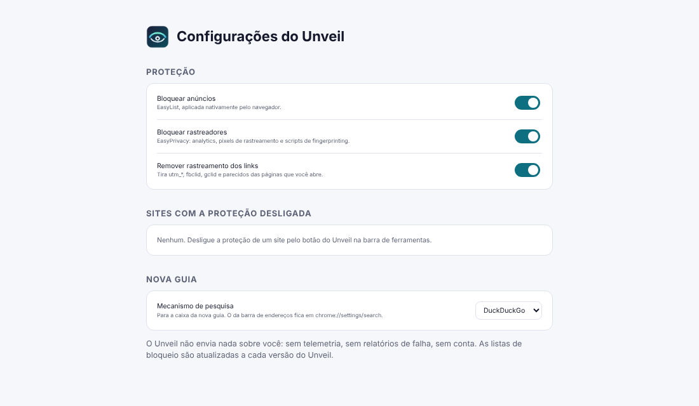

# Unveil

Um navegador leve e sem rastreamento para Windows, feito sobre um fork do Chromium.

<p align="center"></p>

A ideia veio do [Flecha](https://flecha.dev/pt-br/), que funciona assim: Chromium de verdade, um conjunto pequeno de patches e uma interface própria feita como extensão embutida em TypeScript. O Flecha só roda no macOS. O Unveil leva essa ideia para o Windows, com foco em privacidade.

## O que ele faz

**Sem rastreamento (base: [ungoogled-chromium](https://github.com/ungoogled-software/ungoogled-chromium))**
- Sem telemetria, relatórios de falha, Safe Browsing ou sincronização com o Google, e sem requisições de fundo para o Google. O código do ungoogled-chromium tira tudo isso, e os domínios que restam no código-fonte são trocados por endereços inválidos.
- Não precisa de conta. Seus dados ficam em `%LOCALAPPDATA%\Unveil\User Data`.

**Bloqueio de anúncios e rastreadores, embutido e ligado por padrão**
- EasyList (anúncios) e EasyPrivacy (rastreadores, pixels, fingerprinting). Na hora do build, as listas viram regras `declarativeNetRequest`: cerca de 114 mil filtros caem para uns 12,8 mil regras, que o próprio Chromium aplica em código nativo, sem rodar JavaScript a cada requisição.
- Tira `utm_*`, `fbclid`, `gclid`, `msclkid` e outros parâmetros de rastreamento dos links que você abre.
- O botão do Unveil na barra de ferramentas mostra quantos itens foram bloqueados na página e desliga a proteção só naquele site.

**Padrões de privacidade num perfil novo** ([`initial_preferences`](initial_preferences))
- Pesquisa padrão: DuckDuckGo, sem sugestões enquanto você digita.
- Cookies de terceiros bloqueados, modo HTTPS-First, WebRTC sem expor o IP local e sem pré-carregamento de páginas.
- O navegador não continua rodando em segundo plano depois de fechado.

**Nova guia com comandos para desenvolvedores**
- `gh dono/repo`, `npm pacote`, `mdn`, `caniuse` e `so` seguidos dos termos da busca.
- Cole um JWT ou um timestamp Unix para decodificar. O JWT é decodificado na própria página e não é enviado a lugar nenhum.
- Endereços abrem direto (`localhost:3000`, `exemplo.com.br`). O resto vai para o buscador que você escolher.

**É o Chromium**
- As páginas renderizam igual ao Chrome, e as extensões da Chrome Web Store instalam normalmente.
- Os nomes e IDs são próprios, então ele instala ao lado do Chrome ou do Chromium sem conflito.
- A interface está em português e em inglês.

<p align="center"></p>

## Como conseguir

O build oficial roda no GitHub Actions (workflow **build-windows**). Publicar uma tag `v*` gera uma release com:

- `unveil_<versão>_installer_x64.exe`, o instalador (instala só para o seu usuário, em `%LOCALAPPDATA%\Unveil`);
- `unveil_<versão>_windows_x64.zip`, a versão portátil.

```bash
git tag v156.0.8078.47-1 && git push origin v156.0.8078.47-1
```

Um build do Chromium leva muitas horas, mais do que as 6 h que um job do GitHub pode durar. Por isso o workflow roda em etapas encadeadas, cada uma retomando de onde a anterior parou. O build completo leva por volta de um dia. No repositório público, isso não custa nada.

Os binários não são assinados, então na primeira execução o Windows SmartScreen vai mostrar um aviso.

## Compilar na sua máquina (Windows)

São os mesmos requisitos do [ungoogled-chromium-windows](https://github.com/ungoogled-software/ungoogled-chromium-windows#building), mais o Node:

- Windows 10/11 x64, com uns 100 GB livres e 16 GB de RAM ou mais
- Visual Studio 2022 com "Desenvolvimento para desktop com C++" e o Windows SDK 10.0.28000
- Python 3.11+ (com o limite `MAX_PATH` desligado) e `pip install httplib2==0.22.0 clang==21.1.7`
- Node.js 22.18+, Git e 7-Zip

No "Developer Command Prompt for VS":

```cmd
git clone --recurse-submodules https://github.com/daltonfontes/unveil-browser.git
cd unveil-browser
python build.py
python package.py
```

O instalador e o zip saem em `build\`. Se o build falhar no meio, siga as [instruções do upstream](https://github.com/ungoogled-software/ungoogled-chromium-windows#building) para limpar e retomar.

### Mexendo só na interface (sem recompilar o Chromium)

Tudo o que é Unveil e não é C++ fica em [`shell/`](shell): o bloqueio, a nova guia, o popup e as configurações.

```bash
cd shell
npm ci
npm run watch          # recompila ao salvar
npm test               # testes unitários (conversor de listas, comandos)
npm run test:e2e       # carrega a extensão num Chromium real e testa bloqueio, links e nova guia
```

Com um build local do navegador, `.\tools\run-dev.ps1` abre o Unveil carregando a shell de `shell\dist`. Mudou a interface? Basta reiniciar o navegador.

## Como funciona

O Unveil tem três camadas:

1. **ungoogled-chromium-windows** (submódulo, fixado numa tag): o Chromium sem Google e o processo de build no Windows.
2. **Patches do Unveil** ([`patches/`](patches)). São poucos e pequenos, para o Unveil continuar fácil de atualizar:
   - `0001`: nomes e IDs próprios no Windows (pasta de perfil, ProgIDs, registro, notificações).
   - `0002`: carrega a shell como extensão-componente, que não pode ser removida nem desligada. A cada versão nova ela é copiada para a pasta de dados do usuário, porque o Chromium grava o índice das regras de bloqueio na pasta da extensão, e `Program Files` é somente-leitura.
   - `0003`: empacota a shell e o `initial_preferences` no instalador e no zip.
   - `0004`: sem o aviso de "uma extensão mudou sua nova guia" para a nova guia do próprio Unveil.
3. **A shell** ([`shell/`](shell)): uma extensão MV3 em TypeScript. Além dela, o [`build.py`](build.py) aplica a marca ([`branding/`](branding)) e troca "Chromium" por "Unveil" nos textos da interface com o [`tools/rebrand.py`](tools/rebrand.py). Esse script move cada tradução para o novo ID da mensagem, então nenhuma tradução se perde.

### Atualizar o Chromium

1. Aponte o submódulo para a nova tag: `cd ungoogled-chromium-windows && git fetch --tags && git checkout <tag> && git submodule update`.
2. Rode `python3 tools/check_patches.py`. Ele baixa só os arquivos que os patches tocam, na versão nova do Chromium, aplica antes os patches do upstream e depois os do Unveil, sem fuzz, e termina em segundos. A CI ([`check.yml`](.github/workflows/check.yml)) faz a mesma checagem a cada push.
3. Se algum patch falhar, `python3 tools/check_patches.py --keep pasta/` deixa os arquivos já corrigidos para você refazer o patch.

## Ainda não tem

- Barra lateral vertical, Spaces e split view, como no Flecha/Arc. Isso pede patches na janela (views do Windows) e fica para depois que o build base estiver estável.
- Atualização automática: por enquanto, baixe a release nova.
- Ocultar elementos de anúncio na página (filtros cosméticos `##`). Hoje o bloqueio é só de rede, então às vezes sobra um espaço vazio onde estaria o anúncio.
- Builds para ARM64 e x86.

## Licença

BSD 3-Clause, como o Chromium e o ungoogled-chromium. As listas EasyList e EasyPrivacy são distribuídas sob GPLv3/CC BY-SA 3.0 pelos [autores da EasyList](https://easylist.to/).
