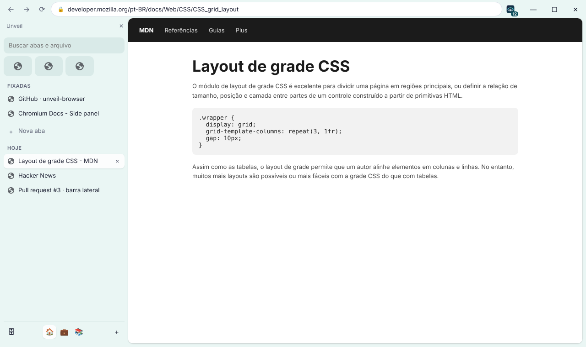
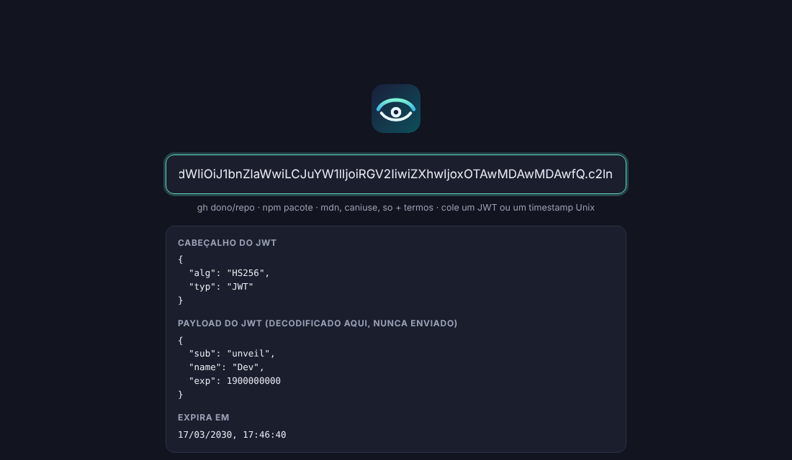
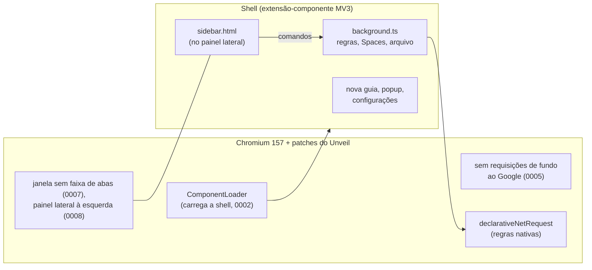

# Unveil

Um navegador leve e sem rastreamento para Windows, feito sobre um fork do Chromium.

<p align="center"></p>

<p align="center"><sub>Prévia: a barra lateral é a real; a linha de cima simula o que os patches 0007, 0008 e 0010 fazem na janela.</sub></p>

## Por quê

O [Flecha](https://flecha.dev/pt-br/) mostrou que dá para fazer um navegador próprio sem carregar um fork gigante: Chromium de verdade, poucos patches e a interface como uma extensão embutida em TypeScript. Mas ele só roda no macOS. O Unveil segue a mesma receita no Windows, com foco em privacidade: nenhum dado sobre você sai do navegador, e anúncios e rastreadores ficam bloqueados desde o primeiro uso.

É o Chromium mesmo, e não um app Electron. As páginas renderizam igual ao Chrome, e as extensões da Chrome Web Store instalam normalmente.

## Recursos

**Barra lateral vertical, como no Flecha**
- As abas ficam numa barra à esquerda, e a faixa de abas horizontal some. A barra de endereço sobe para a linha dos botões da janela, então o navegador ganha espaço vertical.
- **Favoritos** no topo, como ícones, em todos os Spaces. Clicar abre a página ou volta para a aba que já está aberta.
- **Fixadas**: páginas salvas em cada Space. Fechar uma fixada fecha a aba, mas a entrada continua lá para reabrir.
- **Hoje**: as outras abas do Space. As que ficam paradas vão sozinhas para o **arquivo**, depois de 12 horas por padrão (1 dia, 7 dias, 30 dias ou nunca). O arquivo tem busca e reabre a aba com um clique.
- **Spaces** com nome, emoji e cor, que tinge a barra. Cada janela mostra um Space, e as abas dos outros ficam abertas fora de vista. Troque pelos botões no rodapé ou com Alt+Shift+↑/↓.
- **Cookies e logins separados por Space**, como no Flecha: marque a opção ao criar ou editar um Space e os sites dele ganham cookies, armazenamento e cache próprios, guardados no disco. Dá para entrar com uma conta do trabalho num Space e com a pessoal em outro, na mesma janela. Mover uma aba para um Space com outros cookies reabre a aba lá, no mesmo endereço. O botão direito no Space tem "Sair de todas as contas deste Space", e excluir o Space apaga os dados dele.
- **Ctrl+Shift+S** recolhe a barra e a traz de volta, e o botão ⇤ no rodapé também recolhe. Recolhida, a página ocupa a janela toda ([prévia](docs/screenshots/window-collapsed-light.png)). Dá para trocar o atalho em `chrome://extensions/shortcuts`.
- **Split view**: duas abas lado a lado na mesma janela ([prévia](docs/screenshots/window-split-light.png)), usando o split view do próprio Chromium, com a divisória arrastável. Clique com o botão direito numa aba e escolha "Abrir em split view com a aba atual", ou aperte **Alt+Shift+S** para abrir uma aba nova ao lado da atual (o mesmo atalho desfaz o split). Na barra, as duas metades dividem uma linha.
- **Peek**: links que abrem numa aba nova a partir de uma fixada ou de um favorito abrem numa janela flutuante sobre a atual ([prévia](docs/screenshots/window-peek-light.png)). Qualquer link também tem "Abrir no Peek" no botão direito. Esc, o ✕ ou um clique na janela de trás fecha; "Abrir em aba" transforma em aba no mesmo Space. Dá para desligar o Peek automático nas configurações.
- Pela busca da barra você filtra abas, fixadas, favoritos e o arquivo. Se nada bater, o Enter abre a busca, um endereço ou um comando (`gh`, `npm`...) numa aba nova.
- Arraste uma aba para reordenar, para "Fixadas" para fixar ou para os favoritos para favoritar. O botão direito tem o resto: mover para outro Space, duplicar, copiar link, silenciar.
- Janelas anônimas continuam com a faixa de abas do Chromium.

**Sem rastreamento**
- Sem atualizações de componentes do Google (`update.googleapis.com`), sem relatórios de Domain Reliability e sem pings de auditoria de links (`<a ping>`), em toda inicialização (patch 0005).
- Sem chaves de API do Google, então não há login nem sincronização com o Google. Sem telemetria e sem relatórios de falha.
- Num perfil novo ([`initial_preferences`](chromium/build/initial_preferences)):
  - DuckDuckGo como buscador, sem sugestões enquanto você digita;
  - cookies de terceiros bloqueados;
  - HTTPS-First;
  - WebRTC sem expor o IP local;
  - sem pré-carregamento de páginas, Safe Browsing, tradutor, Media Router ou serviço de ortografia do Google.

  São preferências, então dá para mudar em `chrome://settings`.
- Não precisa de conta. Seus dados ficam em `%LOCALAPPDATA%\Unveil\User Data`.

**Bloqueio de anúncios e rastreadores**
- EasyList e EasyPrivacy, ligadas por padrão. No build, cerca de 114 mil filtros viram cerca de 12,8 mil regras `declarativeNetRequest`, que o próprio Chromium aplica em código nativo, sem JavaScript a cada requisição.
- Tira `utm_*`, `fbclid`, `gclid`, `msclkid` e outros parâmetros de rastreamento dos links que você abre.
- O botão do Unveil na barra de ferramentas mostra quantos itens foram bloqueados na página e desliga a proteção só naquele site.

**Nova guia para desenvolvedores**
- `gh dono/repo`, `npm pacote`, `mdn`, `caniuse` e `so` seguidos dos termos da busca.
- Cole um JWT ou um timestamp Unix para decodificar. O JWT é decodificado na própria página e não é enviado a lugar nenhum.
- Endereços abrem direto (`localhost:3000`, `exemplo.com.br`). O resto vai para o buscador que você escolher.

**O resto do navegador**
- Nomes e IDs próprios no Windows (patch 0001), então instala ao lado do Chrome ou do Chromium sem conflito.
- "Chromium" vira "Unveil" em todos os textos da interface, sem perder nenhuma tradução.
- Interface própria em português e inglês, nos temas claro e escuro.

<p align="center"></p>

## Instalação

1. Baixe a versão mais recente em [Releases](https://github.com/daltonfontes/unveil-browser/releases):
   - `Unveil-<versão>-x64-installer.exe` instala só para o seu usuário, em `%LOCALAPPDATA%\Unveil`, sem pedir administrador;
   - `Unveil-<versão>-x64.zip` traz os mesmos arquivos: é só descompactar e abrir o `chrome.exe`.
2. Os binários não são assinados, então na primeira execução o Windows SmartScreen pode mostrar um aviso. Clique em **Mais informações → Executar assim mesmo**.

No Linux (x64, qualquer distro recente):

```sh
tar -xJf unveil-<versão>-linux-x64.tar.xz
cd unveil-<versão>-linux-x64
./install.sh    # opcional: põe o Unveil no menu de aplicativos e em ~/.local/bin
./unveil
```

O perfil fica em `~/.config/unveil`. Se a distro não deixar o Chromium usar user namespaces (é raro), o sandbox precisa do `chrome-sandbox` como root: `sudo chown root:root chrome-sandbox && sudo chmod 4755 chrome-sandbox`.

## Compilar

Você precisa de:

- Windows 10/11 x64, com uns 100 GB livres num SSD e 16 GB de RAM ou mais (32 GB ajudam bastante)
- Visual Studio 2022 com "Desenvolvimento para desktop com C++", os componentes de C++ ATL e MFC e o Windows SDK. Veja as [instruções de build do Chromium para Windows](https://chromium.googlesource.com/chromium/src/+/main/docs/windows_build_instructions.md#visual-studio).
- Git, Node 22.18 ou mais novo e 7-Zip (só para empacotar)
- [depot_tools](https://commondatastorage.googleapis.com/chrome-infra-docs/flat/depot_tools/docs/html/depot_tools_tutorial.html) (o `fetch.ps1` instala se não tiver)
- um checkout do Chromium na versão de [`chromium/build/CHROMIUM_VERSION`](chromium/build/CHROMIUM_VERSION), que hoje é a 157. O `fetch.ps1` baixa: uns 40 GB, e uma hora ou mais.

O [`chromium/scripts/env.ps1`](chromium/scripts/env.ps1) define onde fica cada coisa, e todos os scripts leem dele. Por padrão o checkout fica em `C:\src\chromium\src` e o depot_tools em `C:\src\depot_tools`. Para mudar, use as variáveis `CHROMIUM_SRC`, `DEPOT_TOOLS` e `UNVEIL_PROFILE` (o perfil de desenvolvimento).

Rode no PowerShell (se o Windows bloquear scripts: `Set-ExecutionPolicy -Scope CurrentUser RemoteSigned`):

```powershell
git clone https://github.com/daltonfontes/unveil-browser.git
cd unveil-browser
npm ci
chromium\scripts\fetch.ps1         # uma vez: depot_tools e o Chromium na versão certa
```

### O ciclo de desenvolvimento

```powershell
chromium\scripts\build.ps1         # apply.ps1 (marca, patches, textos) e autoninja -C out\Dev chrome
chromium\scripts\run.ps1           # abre out\Dev\chrome.exe com um perfil próprio
npm run shell:build                # mudou só a interface? recompile a shell e reabra o run.ps1
npm run typecheck
npm test                           # testes unitários
npm run test:e2e                   # a shell num Chromium real (156+): bloqueio, links, nova guia, barra, split view
```

Você pode rodar o `apply.ps1` quantas vezes quiser: ele desfaz a aplicação anterior antes de aplicar de novo. O build de desenvolvimento é um component build, então uma mudança só religa uma DLL pequena. O `run.ps1` carrega a shell de `chromium\shell\dist` pelo `--unveil-shell-dir`, então mexer na interface não exige compilar o Chromium (o `npm run shell:watch` recompila ao salvar).

### Release

```powershell
chromium\scripts\build-release.ps1     # várias horas na primeira vez; pode ser retomado
chromium\scripts\publish-release.ps1   # cria a release v<versão> no GitHub (gh)
```

O `build-release.ps1` faz, nesta ordem:
1. compila a shell e roda o `apply.ps1`;
2. copia a shell e o `initial_preferences` para dentro do checkout;
3. gera o `out\Release\args.gn` a partir do [`chromium/build/release.gn`](chromium/build/release.gn);
4. compila o `chrome` e o instalador (`mini_installer`);
5. chama o `package-release.ps1`, que deixa em `dist\` o instalador, o zip e o `SHA256SUMS.txt`.

Com `UNVEIL_OFFICIAL=1`, ele adiciona `is_official_build`: o navegador sai menor e mais rápido, mas a etapa de link pede uns 64 GB de RAM. Os codecs H.264 e AAC vêm ligados para os vídeos tocarem em todo lugar; veja a observação sobre patentes no `release.gn`.

### Linux

O build de Linux parte do tarball oficial do código do Chromium, como fazem as distros (2 GB para baixar em vez de 40 GB de checkout), com o clang e o Rust do próprio Chromium e o sysroot Debian dele, então o binário roda em qualquer distro recente. Precisa de uns 60 GB livres e 16 GB de RAM.

```sh
chromium/scripts/linux/install-deps.sh   # Debian/Ubuntu: ninja, gperf, go, esbuild...
chromium/scripts/linux/fetch.sh          # o código (../unveil-build/src), o clang, o Rust e o gn
chromium/scripts/linux/build.sh          # apply.sh (marca, patches, textos) e ninja -C out/Release chrome
chromium/scripts/linux/package.sh        # dist/unveil-<versão>-linux-x64.tar.xz
```

### Builds na nuvem

O workflow [`build`](.github/workflows/build.yml) compila o Unveil nos runners gratuitos do GitHub Actions: rode à mão em Actions → build → Run workflow, ou envie uma tag `v*` para ele criar a release com os pacotes. O Chromium demora mais que as 6 horas que um job pode durar, então o build é dividido em etapas de umas 5 horas, e cada etapa entrega a árvore do build para a próxima, que continua de onde parou. Um build completo leva de 15 a 25 horas.

## Organização do repositório

```
chromium/
  patches/       as mudanças no Chromium, como diffs unificados numerados
  branding/      ícone, logos, BRANDING (logo.svg é a fonte de todos)
  build/         CHROMIUM_VERSION, dev.gn e release.gn (args do GN), initial_preferences
  scripts/       env, fetch, apply, build, run, build-release, package-release,
                 publish-release (PowerShell); check-patches, rebrand,
                 render-branding (Node)
  shell/         a extensão MV3 embutida que traz a interface do Unveil
    build.mjs         bundle com esbuild; baixa e converte as listas de bloqueio
    abp2dnr.mjs       filtros Adblock Plus para regras declarativeNetRequest
    src/background.ts liga e desliga as regras conforme as configurações
    src/sidebar/      a barra lateral: a página (sidebar.ts) e o seu lado no
                      service worker (service.ts), único que grava o estado
    src/lib/sidebarState.ts  Spaces, favoritos, fixadas, Hoje e arquivo
    src/lib/partitions.ts    em que partição de armazenamento cada aba abre
    src/newtab/       nova guia e caixa de comandos
    src/popup/        o botão da barra: bloqueios na página, proteção por site
    src/options/      configurações
docs/screenshots/
```

## Arquitetura em resumo

O Unveil é o Chromium mais duas camadas: um conjunto pequeno de patches e uma extensão que traz a interface.



Os patches ficam pequenos e com um assunto cada, para que atualizar o Chromium continue fácil:

| Patch | O que faz |
|---|---|
| 0001 | Nomes e IDs próprios no Windows: pasta de perfil, ProgIDs, registro, notificações |
| 0002 | Carrega a shell como extensão-componente (não pode ser removida nem desligada). A cada versão nova ela é copiada para a pasta de dados do usuário, porque o Chromium grava o índice das regras de bloqueio na pasta da extensão, e `Program Files` é somente-leitura |
| 0003 | Coloca a shell e o `initial_preferences` no instalador |
| 0004 | Tira o aviso de "uma extensão mudou sua nova guia" da nova guia do próprio Unveil |
| 0005 | Desliga as requisições de fundo ao Google: atualização de componentes, Domain Reliability e `<a ping>` |
| 0006 | Tira o aviso de "chaves de API do Google ausentes" |
| 0007 | Janelas normais sem a faixa de abas: as abas ficam na barra lateral (`--unveil-show-tab-strip` traz a faixa de volta) |
| 0008 | O painel lateral fica à esquerda por padrão |
| 0009 | A shell abre a barra lateral em cada janela nova sem precisar de um clique |
| 0010 | A barra ocupa o painel lateral inteiro, sem o cabeçalho do Chromium (título, fixar e fechar) |
| 0011 | `chrome.unveilPrivate`, só para a shell: abrir uma aba numa partição de armazenamento, saber em qual partição uma aba está e apagar uma partição |
| 0012 | Cookies separados por Space: abas e janelas que uma página abre ficam na partição dela, e a limpeza de partições do Chromium não apaga as dos Spaces |

Os patches 0011 e 0012 seguem os patches 0010 e 0034 do Flecha. Cada Space com cookies separados é uma `StoragePartition` persistente (`SiteInstance::CreateForFixedStoragePartition`), em `<perfil>/Storage/ext/unveil-space/`. É uma partição e não um perfil por Space porque um perfil tem extensões e janelas próprias: a barra e os Spaces teriam que ser divididos entre perfis, e as abas de Spaces diferentes não poderiam ficar na mesma janela.

Para "Chromium" virar "Unveil" nos textos, o [`rebrand.mjs`](chromium/scripts/rebrand.mjs) precisa recalcular o ID de cada mensagem. As traduções (`.xtb`) são indexadas por uma impressão digital do texto em inglês, então o script calcula o ID novo do mesmo jeito que o GRIT do Chromium e move cada tradução para ele. Os testes conferem os IDs com valores calculados pelo próprio GRIT.

### Atualizar o Chromium

1. Troque a versão em [`chromium/build/CHROMIUM_VERSION`](chromium/build/CHROMIUM_VERSION).
2. Rode `npm run check-patches`. Ele baixa só os arquivos que os patches tocam, na tag nova, e aplica os patches com `git apply`, sem fuzz. Termina em segundos e não precisa de checkout. A CI faz a mesma checagem a cada push.
3. Se algum patch falhar, `npm run check-patches -- --keep pasta` deixa os arquivos para você refazer o diff.
4. Depois, `chromium\scripts\fetch.ps1` e `build.ps1`.

## Ainda não tem

- O split view é de duas abas, o máximo do Chromium.
- Nos Spaces com cookies separados, o Peek abre uma aba em vez da janela flutuante, porque não dá para pôr uma janela pop-up numa partição. Uma aba nova aberta pelo Chromium (Ctrl+T) nasce no armazenamento comum e reabre na partição do Space logo em seguida. Ao reiniciar, as abas restauradas reabrem na partição do Space em que a janela está.
- Os patches 0011 e 0012 ainda não foram compilados. A parte da shell tem testes num Chromium comum, com um `chrome.unveilPrivate` de mentira; a separação de cookies em si só aparece no build do Unveil.
- O Peek é uma janela pop-up do Chromium, e não uma camada desenhada dentro da janela, como no Flecha (o que exigiria uma moldura de janela própria, em C++). Quando um link de uma fixada abre o Peek, a aba nova que o Chromium cria aparece por um instante antes de virar o Peek.
- A barra vive no painel lateral do Chromium (sem o cabeçalho, patch 0010), então o visual dela segue o do painel: largura pela borda, abrir e fechar como o Chromium faz. No Flecha, a janela inteira é desenhada pela shell, o que dá mais controle.
- Atualização automática: por enquanto, baixe a release nova.
- Ocultar elementos de anúncio na página (filtros cosméticos `##`). Hoje o bloqueio é só de rede, então às vezes sobra um espaço vazio.
- Builds para ARM64.

## Licença

BSD 3-Clause, como o Chromium. A ideia vem do [Flecha](https://github.com/lucianodiisouza/flecha-browser) (MIT). Os patches 0011 e 0012 são adaptados dos do Flecha, e o aviso de licença deles está em [`chromium/patches/FLECHA_LICENSE`](chromium/patches/FLECHA_LICENSE); o resto do código do Unveil é próprio. As listas EasyList e EasyPrivacy são distribuídas sob GPLv3/CC BY-SA 3.0 pelos [autores da EasyList](https://easylist.to/).
